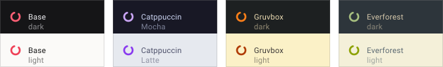

<div align="center">

<picture>
  <source media="(prefers-color-scheme: dark)" srcset=".github/assets/wordmark-dark.svg">
  
</picture>

Save a link. Get the substance back.

[](https://github.com/zenodea/zenow/actions/workflows/ci.yml)
[](https://github.com/zenodea/zenow/actions/workflows/deploy.yml)
[](LICENSE)

</div>

## The idea

Save a link from the browser, your phone or the extension. Zenow reads the page, writes a
short summary with the key points, picks the pictures worth keeping and tags it. Articles,
Reddit threads, YouTube videos and PDFs all work.

The list opens on what you have not read yet. When that is empty it shows everything.

## Reading

Each article opens on the summary: key points first, then a few paragraphs. One tap
switches to the original page, cleaned up and in the same reading font. If you would rather
start on the original, change it once in your account settings.

If a summary cannot be made, the article opens on the original instead, with a small note
saying why.

The summary can also be read aloud, using the voice your device already has.

## Your list

**Unread**, **All** and **Archive** sit at the top. Search covers titles, summaries and the
full text. Tags are added for you and reuse the ones you already have, so the list stays
tidy.

Once a week Zenow writes a digest of what you saved: what the week was about, and whether it
was about anything at all.

## Saving

- **Firefox extension.** A toolbar button, `Ctrl+Shift+U`, or right click a link.
- **Android.** Install the site and use *Share → Zenow* from any app.
- **Paste.** The `+` button on the list.
- **Research.** Ask a question instead of pasting a link, and Zenow searches the web and
  writes up what it found.

## Mobile

The web app works on a phone and installs like an app. Pages you have opened stay readable
without a connection.

## Themes

Four themes, each with a dark and a light version, saved to your account.



## Your keys

Each account brings its own [OpenRouter](https://openrouter.ai) key, so you pay for your own
summaries and pick the model. You can also give Zenow a Fly.io token and it runs a worker
just for you, which sleeps when there is nothing to do.

## Running it locally

```bash
pnpm install
pnpm --filter "./packages/*" build
pnpm --filter @zenow/db migrate
pnpm dev:web       # http://localhost:3007
pnpm dev:worker
```

`apps/web/.env.example` and `apps/worker/.env.example` list what each one needs.

## Layout

| Path                | What it is                                        |
| ------------------- | ------------------------------------------------- |
| `apps/web`          | Next.js app and API. Runs on Vercel.              |
| `apps/worker`       | Fetches and summarises. Runs on Fly.io.           |
| `apps/extension`    | Firefox extension. No build step.                 |
| `apps/mobile`       | Expo app for iOS and Android.                     |
| `packages/shared`   | The API contract, shared by every client.         |
| `packages/db`       | Drizzle schema and migrations.                    |
| `packages/adapters` | Article, Reddit, YouTube and PDF extraction.      |

## Built with

Next.js and React, Tailwind, Drizzle on Neon Postgres, Neon Auth for sign in, OpenRouter
for the summaries. The web app runs on Vercel, the worker on Fly.io, and every push is
checked and shipped by GitHub Actions.

## License

[MIT](LICENSE).
